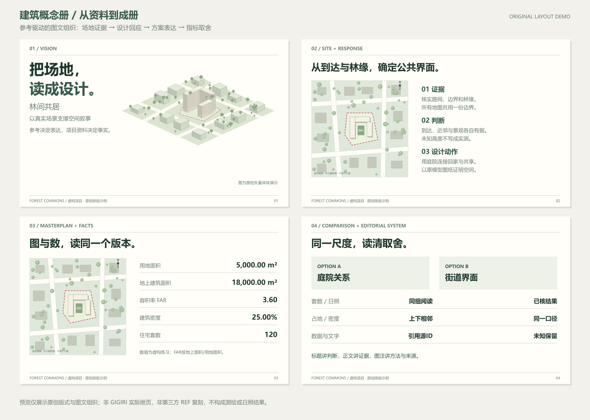
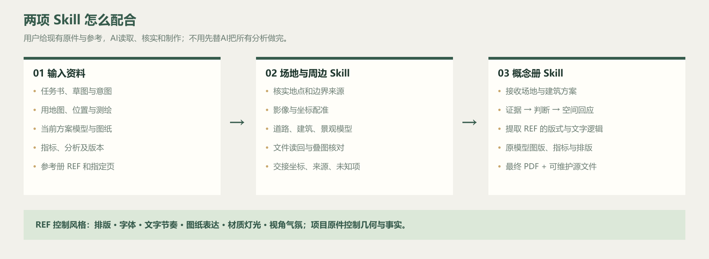

# 建筑概念册：从资料到成册

把模型、图纸、现场资料和设计想法，整理成一本有逻辑、图文清楚、数据有出处的概念方案册。

这是一个 **给 AI 使用的 Skill（制作说明书与配套资源包）**，不是点击一下就自动完成设计的软件。它提炼了 GIGIRI「林界叠居」概念册的实际制作方法，适用于住宅、办公、商业、公共建筑、室内、景观和城市设计，也可用于设计作品集。它不会把那个项目的名称、方案数量、37 页结构或配色套到新项目上。

## 预览



上图是原创虚构项目的四类册页示例，用来展示主图、叙事、来源和指标如何组织；不是 GIGIRI 实际册页，也不复制第三方参考册。可编辑 [SVG图源](docs/previews/concept-book-preview.svg) 随仓库提供。



## 能做什么

| 你的需求 | Skill 如何处理 |
|---|---|
| 文件很多，不知道从哪里开始 | 清点资料、判断版本，区分项目事实、设计意图和待核问题 |
| 有想法，但文本松散 | 建立“问题 → 证据 → 设计回应 → 空间结果”的叙事，写章节和图注 |
| 要做场地分析 | 接收已核场地资料，组织交通、景观、配套、高度、日照等分析；只有用地图时先衔接独立场地 Skill |
| 有多个方案 | 统一方案编号、图纸尺度和指标口径，比较取舍；只有一个方案也可使用 |
| 要放总图、平面、剖面、功能图和效果图 | 按真实输入选择图种，保留模型几何，区分技术图与表现图 |
| 要按上传的 REF 做册子 | 实际读参考页，提取版式、文字逻辑、图纸表达、图像构图与气氛，再用本项目资料转译 |
| 要排成专业册子 | 建立字体、网格、图框和页码系统，先做代表页，再展开全册 |
| 模型或数据更新了 | 找到受影响的图片、正文、表格和页码，局部重建并重新验证 |
| 要最终交付 | 输出约定的 PDF、可维护源文件、来源表和验收记录 |

**不会自动获得的能力：** 没有真实模型就不能承诺原模型出图；没有尺度、坐标或计算依据就不能给出测绘、法定指标或合规结论；效果图不能用来计算面积。需要图像生成、原生软件导出或 PDF 工具时，所用 AI 环境必须确实具备这些能力。

## 怎么使用

### 在 Codex 中使用

1. 从 [Releases](https://github.com/u20260608744-glitch/architecture-concept-book/releases) 下载 `architecture-concept-book.zip` 并解压。
2. 把里面的整个 `architecture-concept-book` 文件夹放入 `~/.codex/skills/`。Windows 通常是 `%USERPROFILE%\.codex\skills\`。
3. 新开对话，让 Codex 可以访问你的项目资料；直接复制下面这段请求。

```text
请使用 $architecture-concept-book。
读取我提供的项目资料，先核查文件和版本，整理设计逻辑与章节计划，
再制作一本中文概念方案册，交付 PDF 和可维护源文件。
页数按内容决定。模型、场地边界和指标以我提供的资料为准，
没有依据的内容保留待核，不要编造。
```

**有参考册时请一起上传，并指定参考页与作用。** 例如：“参考其版式、字体层级、文字逻辑和图纸表达；材质、阳台、灯光、构图与气氛参考另附图片。原模型体块、周边道路建筑和指标保持本项目依据。”AI应先读REF，写出具体转译规则并用代表页验证，不能只换个颜色或写一句“高端风格”。

### 在其他 AI 环境中使用

下载仓库 ZIP，将 `architecture-concept-book/SKILL.md` 和该文件链接到的相关 `references/`、`assets/` 一起提供给 AI，再上传项目资料。只能处理文字的环境可以完成大纲和逐页稿；不能因此声称已生成、打开或验证 PDF。

## 输入要准备到什么程度

最少是一份可读资料和明确目标；能做多深取决于证据。要做类似GIGIRI那种完整概念册，按下列类型提供现有原件，由AI提取，不必先替AI做分析。

| 输入类型 | 关键内容 |
|---|---|
| 任务与意图 | 设计要求、草图、功能目标、读者、语言、交付格式 |
| 用地与现状 | 完整用地图/测量图、位置线索、卫星/照片、边界和高程 |
| 模型与图纸 | 当前原生模型、方案编号/对象范围、单位/真北、总图/平剖面 |
| 指标与分析 | 面积口径、FAR、套数、车位、日照参数与结果、估算依据 |
| 文本与视觉REF | 完整参考册、指定页、版式/文字/图纸/建筑风格分别参考什么 |
| 版本与使用条件 | 旧册、修改标注、保留项、署名/许可和保密范围 |

**[完整输入指南](docs/input-guide.md)**逐类列出文件形式、需保留的字段、可支持能力和缺项影响，并用GIGIRI的资料类型作对照。[可填写提交表](architecture-concept-book/assets/intake.md) 与 [参考册转译表](architecture-concept-book/assets/style-brief.md) 可直接使用。

## 只有用地图时，先用独立场地 Skill

[site-context-model](https://github.com/u20260608744-glitch/site-context-model) 负责“读用地图 → 核实地点 → 获取适用影像 → 标用地边界 → 基地及周边道路、建筑、景观模型”。通过[场地交接说明](architecture-concept-book/references/site-handoff.md)把坐标、单位、真北、边界、来源和未知项传入本Skill，再结合建筑方案、指标与REF成册。已有可靠场景可直接接收，不必重做。

## 文件与详细说明

- [Skill 主入口](architecture-concept-book/SKILL.md)：AI 实际遵循的流程。
- [使用与功能详解](docs/professional-guide.md)：输入、产物、工具条件、安装和全过程。
- [完整输入分类指南](docs/input-guide.md)：让用户知道要提供哪些原件及缺项影响。
- [参考册风格转译](architecture-concept-book/references/style-reference.md)：REF如何落实到版式、文字和建筑表现。
- [从零到成册的方法](architecture-concept-book/references/02-analysis-and-narrative.md)：把分析变成设计论证。
- [GIGIRI 方法提炼](architecture-concept-book/references/gigiri-method.md)：哪些经验可复用，哪些不能照搬。
- [纯虚构练习项目](architecture-concept-book/assets/example/project.json)：演示来源、计算、图版与页面之间的关联，不是实际项目指标。
- [检查工具使用方法](architecture-concept-book/references/tools.md)：资料清点、清单校验、PDF 渲染；这些工具不替代设计和视觉审阅。

概念册制作与交互网页制作是两个任务。需要把已核定的册子变成交互网页时，可另行使用 [建筑交互 HTML Skill](https://github.com/u20260608744-glitch/-HTML-)；本 Skill 不会在未要求时自动增加网页、视频或公开上传。

## 许可与项目资料

本仓库的原创说明、脚本和虚构示例采用 [MIT License](LICENSE)。不包含 GIGIRI 原始模型、实际册页、项目照片、第三方参考 PDF、商标或字体文件。新项目使用的图片、字体、地图和参考资料，需要分别记录来源及使用条件；仓库许可证不授予第三方素材的使用权。

发布时的检查范围见 [验证说明](docs/validation.md)。
